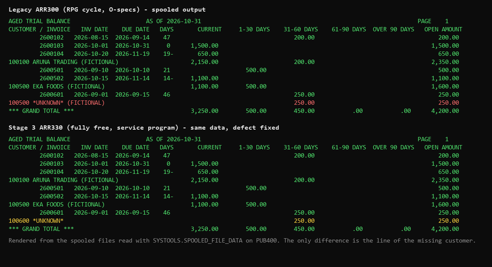
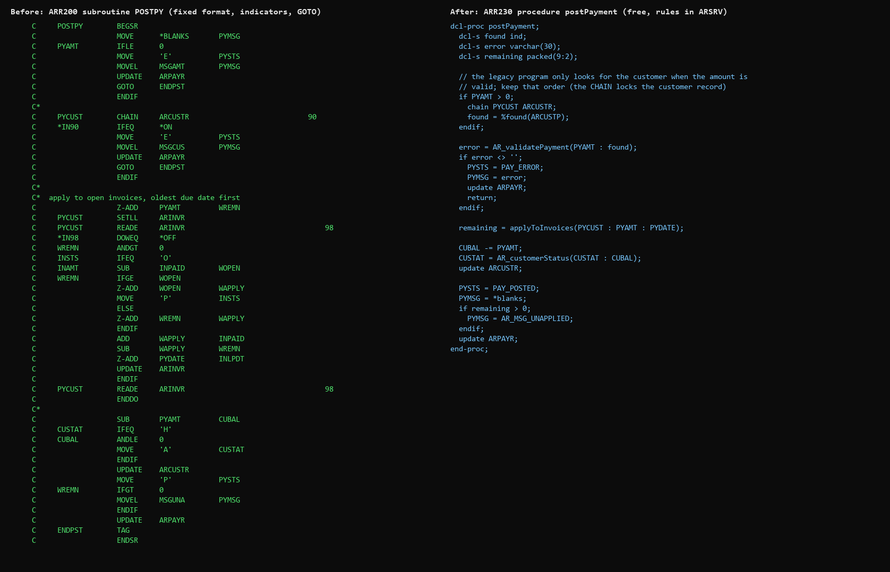
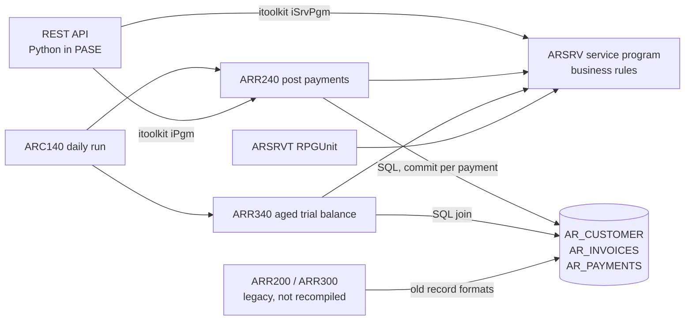

# IBM i Modernization Showcase

A small "legacy" accounts receivable application for IBM i, written the way many
production shops still run it (fixed-format RPG, numbered indicators, the RPG
cycle, O-specs, DDS files), modernized **one safe step at a time**. Every
stage is proven with a regression run: the same test data, the same programs
run, and the database rows plus the printed report must be identical to the
legacy output before the next stage starts.

Built and tested on [PUB400.COM](https://pub400.com) (IBM i 7.5). All names
and data are fictional. This is a sample project, not production code.

## The application

| Object | Type | What it does |
|---|---|---|
| `ARCUSTP` | PF | Customer master: credit limit, balance, status (A active / H on hold) |
| `ARINVP` / `ARINVL1` | PF / LF | Invoices; LF keyed by customer, due date, invoice |
| `ARPAYP` | PF | Payments received, waiting to be posted |
| `ARR200` | RPGLE | Posts each new payment to the customer's oldest open invoices first; rejects amount ≤ 0 and unknown customers; leftover money becomes unapplied credit; releases a customer from hold when the balance reaches zero |
| `ARR300` | RPGLE | Aged trial balance (current, 1-30, 31-60, 61-90, over 90 days) driven by the RPG cycle: primary file, L1 control break, O-specs |
| `ARC100` | CL | Daily run: post payments, then print the report |

## Stages

| # | Stage | Status | Proof |
|---|---|---|---|
| 0 | [Legacy baseline](00-legacy) | ✅ | [`test/out/legacy.txt`](test/out/legacy.txt) |
| 1 | [Fixed format → fully free RPG](01-free) | ✅ | [`test/out/stage1.txt`](test/out/stage1.txt) identical to legacy |
| 2 | [DDS → SQL tables, programs not recompiled](02-ddl) | ✅ | [`test/out/level-ids.txt`](test/out/level-ids.txt), [`stage2-legacy.txt`](test/out/stage2-legacy.txt), [`stage2-free.txt`](test/out/stage2-free.txt) identical to legacy |
| 3 | [Business rules in a service program + RPGUnit tests, known defect fixed](03-srvpgm) | ✅ | [`stage3-rpgunit.txt`](test/out/stage3-rpgunit.txt) 20 tests green; [`stage3-vs-legacy.diff`](test/out/stage3-vs-legacy.diff) = exactly the fixed line |
| 4 | [Native record I/O → embedded SQL, one transaction per payment](04-sql) | ✅ | [`stage4.txt`](test/out/stage4.txt) identical to stage 3; [`stage4-rollback.txt`](test/out/stage4-rollback.txt) |
| 5 | [REST API that reuses the RPG code](05-api) | ✅ | [`stage5-api.txt`](test/out/stage5-api.txt); customers and invoices identical to stage 4 |
| 6 | [Before / after summary](#before--after) | ✅ | this page |

## Before / after

| | Legacy (stage 0) | Modernized (stages 1-5) |
|---|---|---|
| RPG source | fixed format, 192 lines of code | fully free; 352 lines incl. SQL, transactions and a reusable service program |
| Numbered indicators | 6 (`01 40 50 90 98 99`) + `L1`, `LR`, `1P`, `OF` | 0 |
| `GOTO` / `TAG` | 2 | 0 |
| Report | RPG cycle + O-specs | read loop + externally described printer file, one SQL join |
| Business rules | inside the calculation specs of two programs | 6 procedures in service program `ARSRV`, used by the batch **and** the API |
| Unit tests | none | 20 RPGUnit test cases, 28 assertions, all green |
| Database | DDS PF/LF, no constraints | SQL tables, long names, primary keys, `CHECK` constraints, audit columns, journaled |
| Programs recompiled for the DDS → SQL move | — | **none** (record format level identifiers kept) |
| Failure halfway through a payment | data out of balance | one transaction per payment, rollback proven |
| Access from other systems | none | REST API (`GET` customer / aging, `POST` payment) |
| Known defect | `*UNKNOWN*` line prints the previous customer | fixed in its own step, covered by a test |

Every change was checked against the legacy run: the database rows and the
printed report stayed identical, except for the one defect that was fixed on
purpose.







Images are rendered from files of this repository by
[`tools/render_docs.py`](tools/render_docs.py): the report from the spooled
files of the regression runs, the code from the sources.

## Stage details

### Stage 1 — fully free RPG

`ARR200` → [`ARR210`](01-free/qrpglesrc/arr210.rpgle), `ARR300` → [`ARR310`](01-free/qrpglesrc/arr310.rpgle), `ARC100` → [`ARC110`](01-free/qclsrc/arc110.clle)

| | Legacy | Stage 1 |
|---|---|---|
| Numbered indicators (`90`, `98`, `99`, `01`, `40`, `50`) | 6 | 0 — `%found`, `%eof`, named variables |
| `GOTO` / `TAG` | 2 | 0 — early `return` from a procedure |
| Subroutines vs. procedures | 1 `BEGSR` | 6 procedures with parameters and local variables |
| Report | RPG cycle + O-specs to `QSYSPRT` | explicit read loop with a customer break + externally described printer file [`ARR310P`](01-free/qddssrc/arr310p.prtf) |
| CL | OPM-style, no error handling | ILE CL: as-of date validated with `CVTDAT`, one clear escape message on failure |

Fully free RPG has no I- or O-specs, so a cycle program cannot be converted
line by line; it has to be restructured. To prove the restructured report is
the same, the layout of the old O-specs and of the new printer file is
generated from **one table** ([`tools/gen_p1.py`](tools/gen_p1.py)) and the
spooled output is compared line by line.

**A defect found on the way.** The legacy report prints an invoice of a
customer missing from the master file as `100500 *UNKNOWN* (FICTIONAL)`:
a failed `CHAIN` leaves the previous customer's fields in the buffer, and
`MOVEL '*UNKNOWN*'` only overwrites the first nine characters. Stage 1 is a pure
refactor, so the defect is **kept on purpose** (and marked in the code) to keep
the output identical; it is fixed in stage 3 together with a unit test.
Changing behaviour and changing structure in the same step would make the
regression run useless.

### Stage 2 — DDS to SQL, without recompiling a single program

Scripts: [`ar_tables.sql`](02-ddl/qsqlsrc/ar_tables.sql) →
[`ar_switch.sql`](02-ddl/qsqlsrc/ar_switch.sql) (+ two `CRTLF`) ·
rollback: [`ar_rollback.sql`](02-ddl/qsqlsrc/ar_rollback.sql)

- New tables `AR_CUSTOMER`, `AR_INVOICES`, `AR_PAYMENTS` with long SQL names
  and long column names (`CUSTOMER_ID FOR COLUMN CUCUST`), primary keys and
  `CHECK` constraints (status codes, amounts, paid ≤ amount).
- Audit columns maintained by Db2 itself — `ROW CHANGE TIMESTAMP`,
  `GENERATED ALWAYS AS (USER)`, `GENERATED ALWAYS AS (QSYS2.JOB_NAME)` —
  `IMPLICITLY HIDDEN`, so `SELECT *` and the old programs do not see them,
  yet updates made by the untouched RPG programs are stamped.
- The old DDS files are renamed (kept for rollback); each old file name comes
  back as an object over the new table **with the old record format**.

The interesting part is the record format **level identifier**. If it changes,
every program compiled against the old file fails with `CPF4131` until it is
recompiled.

| Old file | Replacement | Level id |
|---|---|---|
| `ARCUSTP` | `CREATE UNIQUE INDEX ... RCDFMT ARCUSTR ADD <old columns>` | `379BF4A6B932F` = DDS |
| `ARPAYP` | `CREATE UNIQUE INDEX ... RCDFMT ARPAYR ADD <old columns>` | `45461E71550F8` = DDS |
| `ARINVP` | DDS logical file over the table ([`arinvplf.lf`](02-ddl/qddssrc/arinvplf.lf)) | `488BA4457B8BB` = DDS |
| `ARINVL1` | DDS logical file over the table ([`arinvl1lf.lf`](02-ddl/qddssrc/arinvl1lf.lf)) | `488BA4457B8BB` = DDS |

Lesson learned on the way: the first attempt used SQL indexes for all four.
`ARINVP` and `ARINVL1` got **new** level identifiers, because an SQL index
always places its key columns first in its record format (`ININV` is the
second field of `ARINVR`). Where the keys are not the leading fields, a DDS
logical file over the SQL table keeps the original field order. Details:
[`test/out/level-ids.txt`](test/out/level-ids.txt).

### Stage 3 — business rules in a service program, with unit tests

[`ARSRV`](03-srvpgm/qrpglesrc/arsrv.rpgle) (NOMAIN module, binder source
[`ARSRVB`](03-srvpgm/qrpglesrc/arsrvb.bnd) with an explicit signature,
prototypes in [`ARSRVPR`](03-srvpgm/qrpglesrc/arsrvpr.rpgleinc), binding
directory `ARBNDDIR`) holds the rules that were buried in the calculation specs:

| Procedure | Rule |
|---|---|
| `AR_validatePayment` | amount ≤ 0 → `INVALID AMOUNT`; unknown customer → `CUSTOMER NOT FOUND` (amount checked first, as in legacy) |
| `AR_applyAmount` | how much of the remaining payment goes to one open invoice |
| `AR_customerStatus` | a customer on hold is released when the balance is ≤ 0 |
| `AR_daysPastDue` | days past due on the as-of date |
| `AR_ageBucket` | current / 1-30 / 31-60 / 61-90 / over 90 |
| `AR_customerName` | name to print, `*UNKNOWN*` for a missing customer |

The procedures do no file I/O, so they can be tested without test data:
[`ARSRVT`](03-srvpgm/qrpglesrc/arsrvt.rpgle) is an
[iRPGUnit](https://github.com/tools-400/irpgunit) suite with every rule,
every bucket boundary (0/1, 30/31, 60/61, 90/91), a leap day and the legacy
defect: `Success. 20 test cases, 28 assertions, 0 failure, 0 error.`

[`ARR230`](03-srvpgm/qrpglesrc/arr230.rpgle) and
[`ARR330`](03-srvpgm/qrpglesrc/arr330.rpgle) now only read and write files
and call `ARSRV`. `ARR330` also uses `SELECT` with an operand and `WHEN-IS`
(a recent RPG enhancement delivered by PTF; it compiled on PUB400, IBM i 7.5) for the buckets.

**The defect is fixed here, in its own step.** The regression run differs from
the legacy output in exactly one line, the one that was wrong:

```diff
< 100500 *UNKNOWN* (FICTIONAL)        ...   250.00   ...   250.00
> 100600 *UNKNOWN*                    ...   250.00   ...   250.00
```

All posted payments, invoices and customer balances are still identical.

### Stage 4 — embedded SQL and one transaction per payment

[`ARR240`](04-sql/qrpglesrc/arr240.sqlrpgle) and
[`ARR340`](04-sql/qrpglesrc/arr340.sqlrpgle) no longer use `CHAIN`, `READE`
or `UPDATE` on record formats; they work on the tables of stage 2 by their
long names, and still take every business rule from `ARSRV`.

| | Stage 3 (native I/O) | Stage 4 (SQL) |
|---|---|---|
| Payments to post | `READ` the whole file, skip posted ones | cursor `WHERE PAY_STATUS = ' '`, `WITH HOLD` so it survives each commit |
| Customer | `CHAIN` (record lock until `UPDATE`) | `SELECT ... WITH RS USE AND KEEP EXCLUSIVE LOCKS`, then `UPDATE` |
| Invoices | `SETLL` / `READE` on the LF, skip paid ones | cursor of open invoices `ORDER BY DUE_DATE` `FOR UPDATE`, `UPDATE ... WHERE CURRENT OF` |
| Report | read every invoice, `CHAIN` per customer | one `SELECT` with `LEFT JOIN`; a missing customer is a NULL, detected with a null indicator; multi-row `FETCH` into a data structure array |
| Failure halfway | invoice already updated, customer not — data out of balance | `COMMIT` per payment; any SQL error → `ROLLBACK` and an escape message |

The tables are journaled (they were created in a library that has a `QSQJRN`
journal), which is what makes commitment control possible. The legacy
program had none.

**Rollback test** ([`stage4-rollback.txt`](test/out/stage4-rollback.txt)):
another job holds a row lock on invoice 2600102. Payment 1 of customer
100100 pays invoice 2600101 in full, then waits for 2600102, times out after
the record wait (about 60 s), and the run ends with an escape message.
Afterwards invoice 2600101 is still unpaid, the balance is still 3,850.00 and
the payment is still waiting — the half-posted payment was rolled back. After
the lock is gone the same command posts everything, and the result is
identical to the normal stage 4 run. An unexpected database error stops the
run instead of skipping the payment: the remaining payments stay waiting and
are posted by the next run.

### Stage 5 — a REST API that reuses the RPG code

[`05-api/server.py`](05-api/server.py): Python 3.9 in PASE, standard library
HTTP server plus [itoolkit](https://github.com/IBM/python-itoolkit) (XMLSERVICE),
both from the IBM i open-source packages.

| Endpoint | What it does |
|---|---|
| `GET /api/health` | checks the database |
| `GET /api/customers/{id}?asof=` | customer, balance, open invoices with days past due and age bucket |
| `GET /api/aging?asof=` | the aged trial balance as JSON |
| `POST /api/payments` | `{"customer":100100,"amount":1500.00,"date":"2026-10-25"}` → `201` posted, `404` unknown customer, `422` invalid amount or date |

No business rule is written twice. The API calls the **same RPG code** the
batch uses:

- the payment is validated by calling the `ARSRV` procedure `AR_validatePayment`
  directly from Python (`iSrvPgm`), so the API and the batch can never disagree;
- an accepted payment is inserted and then posted by **the batch program
  `ARR240` itself** (`iPgm`), with its one-transaction-per-payment logic;
- the age bucket of every invoice comes from `AR_ageBucket`, all calls of one
  request batched into a single XMLSERVICE round trip.

itoolkit's `DirectTransport` runs XMLSERVICE inside the server's own job, so the
server needs no user or password. (On PUB400 a local `ibm_db` connection is
refused without credentials, SQL30082.) Input is parsed into numbers and dates
before it reaches a statement; nothing from the request is pasted into SQL as
text. Errors come back as JSON without stack traces.

**Test** ([`test_api.py`](05-api/test_api.py) →
[`stage5-api.txt`](test/out/stage5-api.txt)): the seven payments of the test
data are sent one by one through `POST /api/payments`. Status codes
`201 201 201 404 422 201 422` as expected; the aging totals from the API
(3,250.00 / 500.00 / 450.00 / 0 / 0 = 4,200.00) equal the printed report; all
customers and invoices are identical to the stage 4 batch run. The difference
is in the payments table, by design: the API refuses invalid payments with an
HTTP error instead of storing them with status `E`.

**Found on the way:** calling `AR_daysPastDue` through XMLSERVICE failed
(`ILECALL failed`) whenever the result was negative, i.e. for invoices not yet
due, although the procedure passes its RPGUnit test for exactly that case. The
API therefore takes days past due from SQL and only the bucket rule from RPG.
Not yet explained; noted rather than hidden.

Run it from a PC through an SSH tunnel: [`start_api.sh`](05-api/start_api.sh).

## How the regression run works

1. [`test/testdata.sql`](test/testdata.sql) reloads 5 customers, 13 invoices
   and 8 payments — one payment per business rule (full, partial, several
   invoices, overpayment, unknown customer, zero, negative, already posted).
2. The CL program of the stage runs with as-of date `2026-10-31`.
3. All rows of the three files and the spooled report are written to
   `test/out/<stage>.txt` and compared with `diff` against `legacy.txt`.
   Any difference must be an intended one (stage 3: the fixed defect).

## Repository layout

```
00-legacy/   qddssrc (PF, LF) · qrpglesrc (ARR200, ARR300) · qclsrc (ARC100)
01-free/     qddssrc (ARR310P printer file) · qrpglesrc (ARR210, ARR310) · qclsrc (ARC110)
02-ddl/      qsqlsrc (tables, switch, rollback) · qddssrc (logical files over the tables)
03-srvpgm/   qrpglesrc (ARSRV module + binder source + prototypes, ARSRVT tests, ARR230, ARR330) · qclsrc (ARC130)
04-sql/      qrpglesrc (ARR240, ARR340 - SQLRPGLE) · qclsrc (ARC140)
05-api/      server.py (REST API, Python + itoolkit) · test_api.py · start_api.sh
test/        testdata.sql · out/ (regression results, level identifiers, API test)
tools/       gen_p1.py (fixed-format generator, shared report layout) · render_docs.py
docs/        before / after images
```

Program objects go to one library and data to another (`DODIKIBMI1` /
`DODIKIBMI2` on PUB400); change the library names in the SQL scripts to use
your own.

## Build it on your own IBM i

Replace `DODIKIBMI1` (programs, source files `QRPGLESRC`, `QDDSSRC`, `QCLSRC`)
and `DODIKIBMI2` (data, with a `QSQJRN` journal so new tables are journaled)
with your own libraries. [iRPGUnit](https://github.com/tools-400/irpgunit) is
needed for the tests, Python 3.9 with `itoolkit` (IBM i open-source packages)
for the API.

```text
/* stage 0 - legacy                                                       */
CRTPF  FILE(DTA/ARCUSTP) SRCFILE(QDDSSRC)   /* also ARINVP, ARPAYP          */
CRTLF  FILE(DTA/ARINVL1) SRCFILE(QDDSSRC)
CRTBNDRPG PGM(ARR200)  ·  CRTBNDRPG PGM(ARR300)  ·  CRTBNDCL PGM(ARC100)
RUNSQLSTM SRCSTMF('test/testdata.sql') COMMIT(*NONE)
CALL ARC100 PARM('20261031')

/* stage 1 - CRTPRTF FILE(ARR310P), CRTBNDRPG ARR210 ARR310, CRTBNDCL ARC110 */
/* stage 2 - RUNSQLSTM ar_tables.sql, ar_switch.sql, then the two CRTLF     */
/*           (ARINVPLF -> ARINVP, ARINVL1LF -> ARINVL1)                       */
/* stage 3                                                                    */
CRTRPGMOD MODULE(ARSRV) SRCFILE(QRPGLESRC)
CRTSRVPGM SRVPGM(ARSRV) EXPORT(*SRCFILE) SRCFILE(QRPGLESRC) SRCMBR(ARSRVB)
CRTBNDDIR BNDDIR(ARBNDDIR)  ·  ADDBNDDIRE BNDDIR(ARBNDDIR) OBJ((ARSRV *SRVPGM))
CRTBNDRPG ARR230, ARR330  ·  CRTBNDCL ARC130
RUCRTRPG TSTPGM(ARSRVT) SRCFILE(QRPGLESRC) BNDSRVPGM(ARSRV)
RUCALLTST TSTPGM(ARSRVT)
/* stage 4 - CRTSQLRPGI ARR240, ARR340 (COMMIT(*CHG) is set in the source) */
/* stage 5 - copy 05-api to the IFS, run start_api.sh                        */
```

The `RPGLEINC` member `ARSRVPR` is the copybook of prototypes; it is not
compiled on its own.
